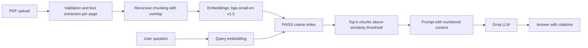

# Task 1: PDF Document Assistant (RAG)

Upload one or more PDFs, ask questions in natural language and receive answers grounded in the documents, with citations that name the file, page and chunk.

## Architecture



### Workflow

1. **Ingestion** (`rag/loader.py`): checks extension, `%PDF-` header, size limit and encryption, then extracts text page by page with `pypdf` and normalises whitespace and hyphenated line breaks.
2. **Chunking** (`rag/chunker.py`): a recursive splitter that prefers paragraph breaks, then lines, sentences and words, and finally hard splits. Each page is chunked separately so every chunk keeps its page number.
3. **Embedding** (`rag/embedder.py`): `BAAI/bge-small-en-v1.5` through `fastembed`. Vectors are L2 normalised, so inner product equals cosine similarity.
4. **Storage** (`rag/store.py`): per-document vectors are kept in memory and a FAISS `IndexFlatIP` is rebuilt whenever a document is added, replaced or removed, so the index never goes stale.
5. **Retrieval** (`rag/pipeline.py`): the query is embedded with the model's query mode, the top 4 chunks are fetched and anything below a similarity of 0.25 is dropped.
6. **Generation** (`rag/generator.py`): a system prompt restricts the model to the numbered passages and tells it to answer with a fixed refusal sentence when the answer is absent. If no chunk passes the threshold the LLM is not called at all.
7. **UI** (`app.py`): chat history, expandable source passages with similarity scores, and per-document removal.

## Design decisions

### Chunk size 900 characters, overlap 150

- 900 characters is roughly 200 tokens. That is large enough to hold a full paragraph or a small section, and small enough that each vector represents one idea instead of blending several topics.
- It sits well below the 512-token input limit of the embedding model, so nothing is silently truncated.
- Four retrieved chunks give about 3,600 characters of context, which keeps prompts cheap and within free-tier token limits.
- An overlap of 150 characters (about 17%) keeps a sentence that straddles a boundary intact in at least one chunk without duplicating much text.

### Embedding model: `BAAI/bge-small-en-v1.5`

- 384 dimensions and about 130 MB, strong retrieval quality for its size.
- `fastembed` runs it on ONNX Runtime, so there is no PyTorch dependency. That keeps installs fast and fits the memory of free hosting.
- It supports asymmetric search, with separate query and passage encodings.
- It is English-focused. For multilingual documents swap in a multilingual model in `rag/config.py`.

### Vector store: FAISS flat index

A flat index gives exact search with no tuning, which is the right trade-off for the few thousand chunks a user session produces.

### LLM: Groq

Free tier, fast inference. Temperature is 0.1 to favour faithful answers. Groq retires models periodically, so the model name is configurable through `GROQ_MODEL`. If you see a 404 error, the model has been retired. Check https://console.groq.com/docs/models for current IDs.

## Error handling

| Situation | Behaviour |
|-----------|-----------|
| Non-PDF or fake PDF | Clear unsupported-format message |
| Password-protected PDF | Asks the user to remove the password |
| Scanned or image-only PDF | Explains that no extractable text was found |
| Corrupt file | Corrupt-document message |
| File over 25 MB | Size-limit message |
| Question before any upload | Prompts the user to process a PDF first |
| Answer not in the document | Fixed "could not find" reply |
| LLM rate limit or connection failure | Friendly message, app keeps running |

Errors in one file never block the other files in the same batch.

## Setup

```bash
python -m venv .venv
source .venv/bin/activate
pip install -r requirements-dev.txt
cp .env.example .env
```

Edit `.env` and set `GROQ_API_KEY`. Then:

```bash
python -m pytest
streamlit run app.py
```

The embedding model is downloaded from Hugging Face on first run and cached afterwards.

On Streamlit Community Cloud set `GROQ_API_KEY` in the app secrets and use `task1-rag/app.py` as the main file.

## Configuration

| Variable | Default | Purpose |
|----------|---------|---------|
| `GROQ_API_KEY` | none | Required |
| `GROQ_MODEL` | `openai/gpt-oss-120b` | Chat model |

Chunk size, overlap, top-k and the similarity threshold live in `rag/config.py`.

## Tests

`python -m pytest` runs 36 tests covering chunking, PDF extraction edge cases (empty, scanned, encrypted, corrupt, oversized), index refresh behaviour and the full pipeline with a fake embedder and generator.

## Known limitations

- Scanned PDFs are rejected because there is no OCR step. Adding `pytesseract` would address this.
- Tables and multi-column layouts may extract in the wrong reading order.
- The index lives in memory and is lost when the session or server restarts.
- Follow-up questions are retrieved using only the latest message, so pronouns such as "it" may retrieve poorly. A query-rewriting step would fix this.
- Dense retrieval can miss exact identifiers. Hybrid search with BM25 and a reranker would improve recall.
- The free Groq tier enforces rate limits that vary by model and account. Check the Groq console for current values.
- The similarity threshold of 0.25 was chosen as a sensible default and should be tuned on real documents.
