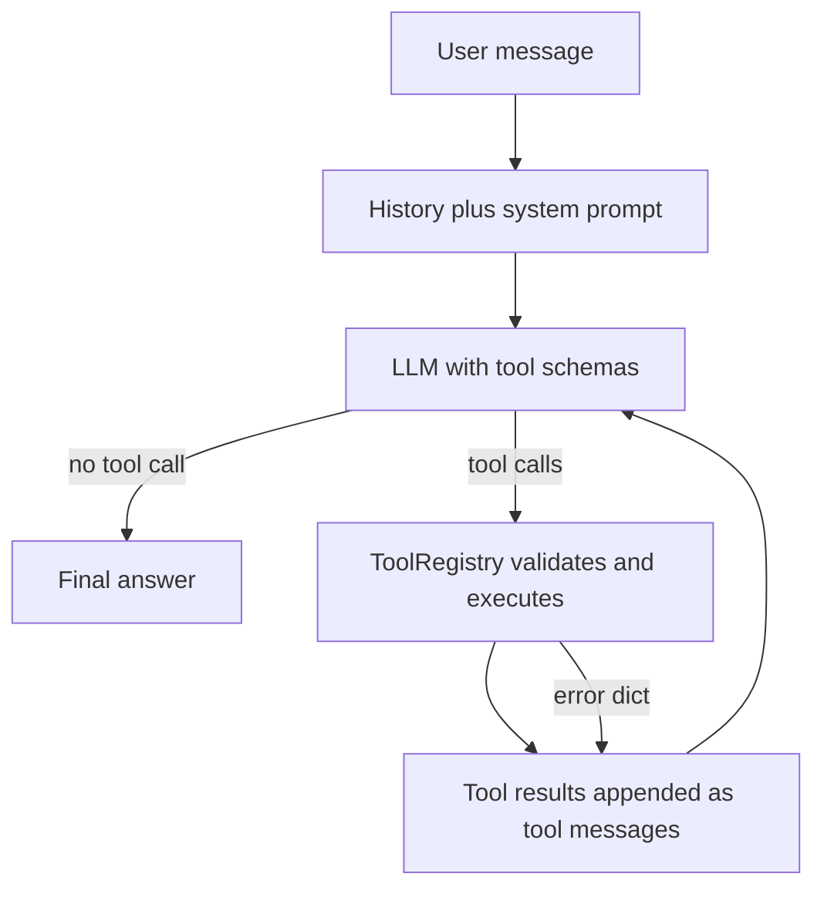

# Task 2: AI Agent with Tool Calling

A chat agent that decides on every message whether to answer directly or call one or more tools, then writes a clear reply from the tool results. It keeps conversation history, so follow-ups such as "convert that to euros" work.

## Architecture



### Modules

| File | Responsibility |
|------|----------------|
| `agent/registry.py` | `Tool` and `ToolRegistry`: JSON schemas, argument parsing, type and enum validation, numeric-string coercion, exception containment |
| `agent/tools.py` | The four tool implementations and their schemas |
| `agent/core.py` | `ToolCallingAgent`: the reasoning loop, history, error translation |
| `agent/config.py` | Model name, step limit, timeouts |
| `app.py` | Streamlit chat UI |

### Decision making

The agent uses the model's native function calling with `tool_choice="auto"`. The system prompt tells it to answer greetings, opinions and confident general knowledge directly and to use tools for arithmetic, weather, money and reference lookups. The loop then works as follows:

1. Send history and tool schemas to the model.
2. If the response has no tool calls, that is the final answer.
3. Otherwise execute every requested call, append the results as `tool` messages, and ask the model again. This supports several tools in one step and tools chained across steps, such as converting currency and then doing arithmetic on the result.
4. After 5 tool rounds, tools are withheld so the model must write a final answer. This prevents infinite loops.

### Error handling

- Every tool returns a dictionary and signals problems with an `error` key instead of raising. The model reads the error and explains it to the user.
- The registry catches unknown tools, invalid JSON, missing or unknown parameters, wrong types and invalid enum values before the tool runs, and catches any unexpected exception inside a tool.
- Network problems are mapped to specific messages for timeouts, connection failures, HTTP 429 and unreadable responses.
- LLM errors (rate limit, connection, authentication, bad request) become friendly messages and the failed turn is removed from history, so the conversation stays consistent.

## Tools

| Tool | Purpose | Parameters |
|------|---------|------------|
| `calculator` | Safe arithmetic through an AST whitelist. No `eval`. Supports `+ - * / // % **`, parentheses, `pi`, `e`, `sqrt sin cos tan log log10 exp abs round floor ceil` | `expression: string` (required) |
| `get_weather` | Current conditions and 3-day forecast from Open-Meteo, with geocoding | `location: string` (required), `units: "celsius" \| "fahrenheit"` |
| `search_wikipedia` | Intro summary and link for the best matching article | `query: string` (required) |
| `convert_currency` | Live rates from the Frankfurter API | `amount: number`, `from_currency: string`, `to_currency: string` (all required, ISO 4217 codes) |

The calculator rejects names, attribute access, comprehensions, strings, huge exponents and over-long input.

## Example prompts

Answered directly with no tool:

- "Hi! What can you do?"
- "What is the capital of Japan?"
- "Explain recursion in one paragraph."

Single tool:

- "What is 18% of 2450 plus the square root of 144?" uses `calculator`
- "What's the weather in Hyderabad?" uses `get_weather`
- "Convert 250 USD to INR" uses `convert_currency`
- "Who was Ada Lovelace?" uses `search_wikipedia`

Multiple tools:

- "Compare the weather in London and Tokyo and tell me which is warmer" calls `get_weather` twice
- "Convert 100 EUR to GBP and then multiply the result by 12" chains `convert_currency` and `calculator`

Follow-up using history:

- "Weather in Paris?" then "And in Berlin?" then "Which one is colder?"

Graceful failure:

- "Weather in Zzzzzzville" returns a polite not-found explanation
- "Convert 10 USD to XYZ" explains the currency is unsupported

The UI shows each tool call with its arguments and result in an expandable panel.

## Setup

```bash
python -m venv .venv
source .venv/bin/activate
pip install -r requirements-dev.txt
cp .env.example .env
```

Edit `.env` and set `GROQ_API_KEY`. Then:

```bash
python -m pytest
streamlit run app.py
```

On Streamlit Community Cloud set `GROQ_API_KEY` in the app secrets and use `task2-agent/app.py` as the main file.

## Configuration

| Variable | Default | Purpose |
|----------|---------|---------|
| `GROQ_API_KEY` | none | Required |
| `GROQ_MODEL` | `openai/gpt-oss-120b` | Any Groq model that supports tool calling |

## Tests

`python -m pytest` runs 51 tests: calculator safety and correctness, every tool's success and failure paths with a fake HTTP session, and the agent loop with a scripted fake LLM covering direct answers, chained and parallel calls, malformed arguments, loop limits, history and LLM failures.

## Known limitations

- No streaming of responses.
- Tool results stay in history, which uses more tokens in long chats. History is capped at the last 20 messages.
- Open-Meteo, Wikipedia and Frankfurter are free public services with their own fair-use limits. Frankfurter supports a limited set of currencies.
- Wikipedia search returns only the single best match, which can be the wrong article for ambiguous queries.
- Smaller models occasionally choose the wrong tool or format arguments badly. The registry validates and coerces arguments to reduce this.
- Conversation history is held per browser session and is not persisted.
