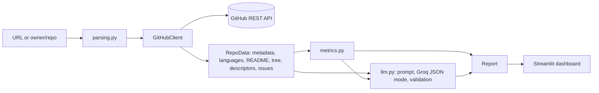

# Task 3: GitHub Repository AI Analyzer

Enter a public GitHub repository and get repository metrics, a health checklist, an AI-written technical review with at least three actionable recommendations, and contribution opportunities including open beginner-friendly issues.

## Architecture



| File | Responsibility |
|------|----------------|
| `analyzer/parsing.py` | Accepts `owner/repo`, full URLs, `.git` URLs, SSH URLs and deep links such as `/tree/main/src` |
| `analyzer/github_client.py` | REST calls, optional token, rate-limit, not-found, empty-repo and network error handling |
| `analyzer/metrics.py` | File counts, extension breakdown, language percentages, detection of tests, CI, Docker, docs, linters, licence and community files, and a 0 to 100 health score |
| `analyzer/llm.py` | Prompt construction, JSON-mode request, tolerant JSON extraction, schema validation and one retry |
| `analyzer/service.py` | Orchestrates the steps into a `Report` |
| `app.py` | Dashboard with AI analysis, metrics and contribution tabs |

## GitHub data fetched

| Endpoint | Used for |
|----------|----------|
| `GET /repos/{owner}/{repo}` | Description, stars, forks, open issues, licence, topics, default branch |
| `GET /repos/{owner}/{repo}/languages` | Language breakdown |
| `GET /repos/{owner}/{repo}/readme` | README text |
| `GET /repos/{owner}/{repo}/git/trees/{branch}?recursive=1` | Full directory structure in a single call |
| `GET /repos/{owner}/{repo}/contents/{file}` | Package descriptors such as `package.json`, `pyproject.toml`, `requirements.txt` |
| `GET /repos/{owner}/{repo}/issues?labels=...` | Open `good first issue` and `help wanted` items, with pull requests filtered out |

A repository costs about 6 to 10 requests. Unauthenticated access allows 60 requests per hour, so a token is strongly recommended.

## How the AI analysis works

The model receives repository facts, structure metrics, up to 250 file paths (shallowest first), package descriptors, beginner issues and the first 6,000 characters of the README. It is instructed to use only those facts and return JSON containing an executive summary, tech stack, strengths, architecture patterns, code organization, recommendations and contribution opportunities.

The response is validated in code. It must contain a summary and at least three complete recommendations. Priorities and categories are normalised to known values. Malformed output triggers one retry. Rate-limit and authentication errors are not retried.

The health score is computed deterministically from observable facts, so it is reproducible and independent of the LLM.

## Error handling

| Situation | Message |
|-----------|---------|
| Empty or malformed input, non-GitHub hosts | Explains the expected format, no request is sent |
| Repository missing or private | Not found, may be private |
| GitHub rate limit | Notice with reset time and a hint to add a token |
| Invalid token | Asks the user to check the token |
| Empty repository | Says the repository is empty |
| Timeout or no connection | Network message |
| Model returns invalid output | Retries once, then a clear error |
| Missing Groq key | Clear configuration message |

## Setup

```bash
python -m venv .venv
source .venv/bin/activate
pip install -r requirements-dev.txt
cp .env.example .env
```

Edit `.env`:

- `GROQ_API_KEY` is required.
- `GITHUB_TOKEN` is optional. Create a fine-grained or classic token with no extra scopes for public repositories at https://github.com/settings/tokens.

```bash
python -m pytest
streamlit run app.py
```

The token can also be pasted into the sidebar field. It is used only for that session.

On Streamlit Community Cloud set `GROQ_API_KEY` and optionally `GITHUB_TOKEN` in the app secrets and use `task3-github-analyzer/app.py` as the main file.

## Tests

`python -m pytest` runs 49 tests: URL parsing, every GitHub error path using a fake session, metrics detection, JSON extraction and validation, retry behaviour and a full end-to-end report.

## Known limitations

- Analysis is based on metadata, README, file names and package descriptors. Source code contents are not read, so claims about internal code quality are inferred from structure.
- Very large repositories may have a truncated tree listing from GitHub, and counts are then approximate.
- Only the default branch is analysed.
- Monorepos with many descriptors only have top-level descriptors read.
- The health score checks for the presence of files, not their quality.
- Unauthenticated GitHub access is limited to 60 requests per hour.
